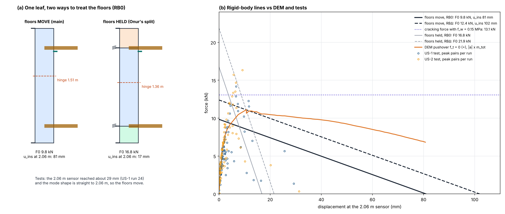
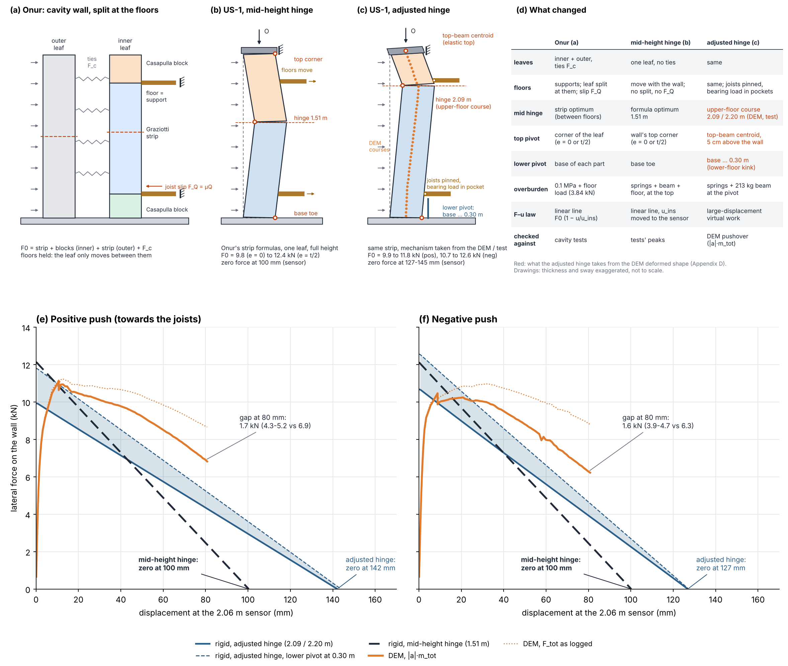
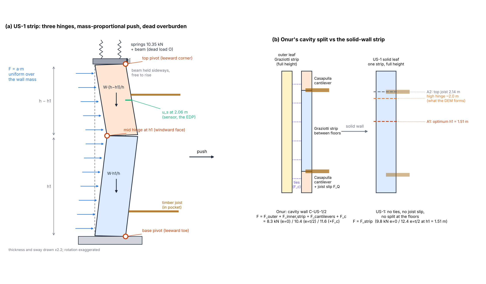
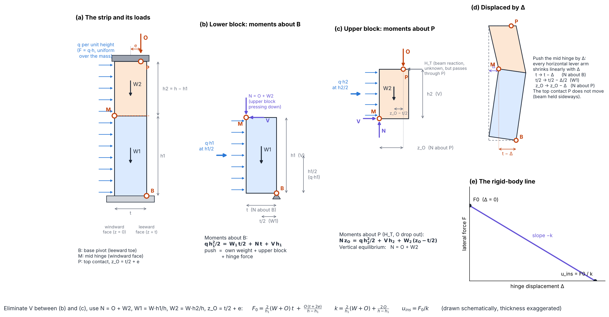
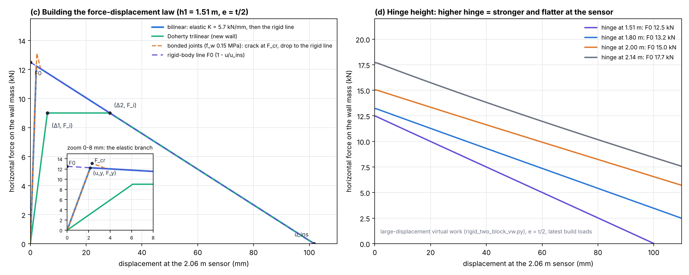
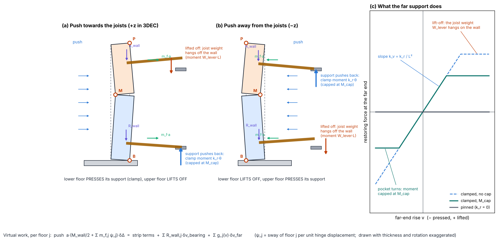
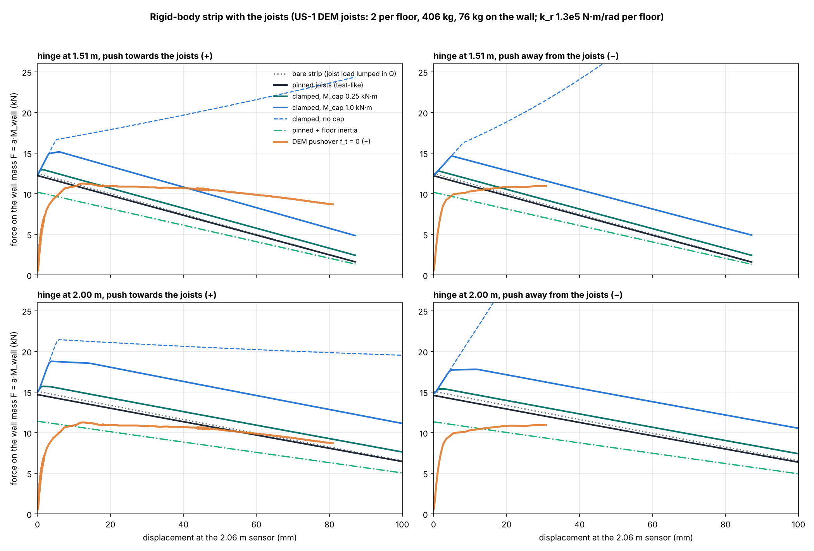
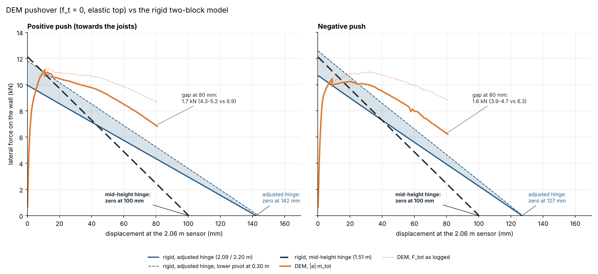

# Mechanical model for the US-1 solid wall: Onur Arslan's formulation, one leaf, floors moving

*Hanze SAFEGO, 23 Oct 2026. Files: `mechanical_model_US1/`.*

## 1. Purpose

The model is an analytical, rigid-body check on the DEM pushover and on the tests of the US-1 (Test 9) solid wall. From equilibrium alone it gives:

- the rocking capacity F0;
- the displacement u_ins at which the wall becomes unstable.

It uses **Onur Arslan's formulation for the cavity specimens** (`SafeGo_Mechanic_Model_v1.xlsx`, sheet `SafeGo_Model_v1`, and `safego_rocking_model.docx`), with the cavity-only parts removed. The floors are assumed to move with the wall, as the tests show. The details of the strip are in Appendix A, the joists in Appendix B, and Onur's split with the floors held in Appendix C.

---

## 2. Onur's model (cavity walls C-US-1 / C-US-2), in brief

Onur combines two published mechanisms:

| Part | What it represents | Formulation | Sheet cells |
|---|---|---|---|
| Inner leaf between the floors (calcium silicate, t = 100 mm, h = 1.72 m) | one-way strip with three hinges | Graziotti et al. (2016) / Tomassetti et al. (2018) | column B, rows 14–47 |
| Outer leaf, full height (clay, t = 100 mm, h = 2.58 m, no top moment: a_t = 0) | one-way strip | same | column C |
| Inner-leaf masonry above the upper floor (h = 0.418 m) and below the lower floor (h = 0.454 m) | cantilever rigid blocks rocking on their base | Casapulla et al. (2017) | K3–R7 |
| Wall ties (10 ties, M_i = 3000 N·mm, V_i = 100 N) | coupling force F_c between the leaves | tie plastic moments and shears | B37–B42 |
| Timber joists in pockets | Coulomb friction F_Q = Q · 0.6 when a joist slips | added to the lower cantilever block | L7, P6/P7 |

Capacities add up as the sum of both leaves' rocking forces, the two cantilever blocks, and the tie coupling force F_c:

- RB0, overburden at mid-thickness (e = 0): **8.26 kN**
- RBΔ, overburden at the edge (e = t/2 = 50 mm): **10.41 kN**
- RBΔ + F_c: **11.62 kN**

The instability displacement comes from the inner leaf only (u_ins = 77.5 mm), with u_ins,Δ = t = 100 mm. Other inputs: overburden 0.1 MPa (as a stress), floor dead load 3.84 kN, flexural bond strength f_w = 0.42 MPa (inner) and 0.46 MPa (outer).

---

## 3. The US-1 model: Onur's formulation, one leaf, the floors move with the wall

### 3.1 The idealisation

The floors are **not** lateral supports. In US-1 the joists rest on supports that slide at their far ends. The 2.06 m sensor, 8 cm below the upper floor, reached about 29 mm (US-1 run 24), and the tests' small-amplitude mode shape is a straight line up to 2.06 m. So the floors move with the wall.

The whole leaf therefore spans from the base to the top beam as **one Graziotti / Tomassetti three-hinge strip**. That is how Onur treats his outer leaf (sheet column C), applied here to the single US-1 leaf with the top joint restrained (a_t = 1). Compared with his cavity model:

- **removed:** the outer leaf and the tie coupling force F_c (US-1 has one leaf and no ties);
- **removed:** the split at the floors, the two cantilever blocks and the joist slip friction (the floors move with the wall, so the joists don't slide in their pockets);
- **kept:** his formulas for the strip, RB0/RBΔ, and u_ins with u_ins,Δ = t.

```
F0 = F0,strip(full height)           u_ins = u_ins of the strip (RB0);   u_ins,Δ = t (RBΔ)      -- at the hinge
```

### 3.2 Inputs

| Quantity | Value | Note |
|---|---|---|
| t, h, b | 0.21 m, 2.58 m, 1.292 m | |
| self-weight W | 13.16 kN | latest build: 1340 kg = 13.15 kN |
| overburden O | springs 10.35 + beam 1.485 + upper floor 1.18 = 13.02 kN | the upper floor's load is lumped at the top. Putting it at 2.14 m instead changes F0 by about 0.1 kN. The lower floor sits in the lower block near the base and adds less than 0.1 kN, so it is left out. |
| bond strength f_w | 0 (the f_t = 0 DEM build); 0.15 MPa (the next build) | Onur: 0.42 MPa |
| sensor | 2.06 m | the tests' and the DEM's displacement |

### 3.3 Formulas (Graziotti et al. 2016; Tomassetti et al. 2018)

Per unit width, with W and O as line loads (N/mm), t and h in mm, f_w in MPa; multiply forces by b/1000 for kN:

```
M_b  = (f_w + (W + O)/t) t^2 / 6                       moment capacity at the base joint
M_t  = (f_w + O/t) t^2 / 6                             moment capacity at the top joint
zeta = f_w + (1/t) [ W/2 + O + 3 (a_b M_b + a_t M_t)/t ]
dM   = a_b M_b - a_t M_t
F_cr = [ zeta + sqrt( zeta^2 - W^2/(4 t^2) - dM/t^3 - dM^2/t^4 ) ] / ( 3h / (2 t^2) )     cracking force
h1   = [ 0.5 + (W t/6 + dM) / (h F_cr) ] h                                               height of the mid hinge
F0   = (2/h1)(W + O) t + O (t + 2e)/(h - h1)                                             rigid-body capacity
u_ins = [ (2/h1)(W + O) t + O (t + 2e)/(h - h1) ] / [ (2/h1)(W + O) + 2 O/(h - h1) ]     instability displacement at h1
```

After cracking, the rigid-body line is F(u) = F0 (1 − u/u_ins).

- e = 0 is RB0 (overburden at mid-thickness).
- e = t/2 is RBΔ (overburden at the compressed edge).

These are Onur's own formulas (sheet rows 24–47), transcribed in `rocking_model.py` (`graziotti()`). Appendix A.2 shows how they follow from moment equilibrium of the two blocks (Figure A2).

**Displacement at the sensor.** The sensor sits on the upper block, between the hinge and the top beam, so it moves a fraction of the hinge displacement:

```
u_s = u_hinge · (h − z_s)/(h − h1)          (2.58 − 2.06)/(2.58 − 1.51) = 0.49 for the RB0 hinge
```

### 3.4 Results



*Figure 1. (a) One leaf, with the floors moving (the model used) and with the floors held (Onur's split, Appendix C). (b) The rigid-body lines at the 2.06 m sensor, against the f_t = 0 DEM pushover and the tests' peak force–displacement pairs per run (2.317 removed). The dotted line is the cracking force for f_w = 0.15 MPa.*

| Case | F0 | F_cr | hinge h1 | u_ins at the hinge | u_ins at 2.06 m |
|---|---|---|---|---|---|
| RB0 (e = 0), f_w = 0 | **9.8 kN** | 4.2 kN | 1.51 m | 167 mm | **81 mm** |
| RBΔ (e = t/2), f_w = 0 | **12.4 kN** | 4.2 kN | 1.51 m | 210 mm (= t) | **102 mm** |
| RB0, f_w = 0.15 MPa | 10.3 kN | **13.1 kN** | 1.36 m | 173 mm | 74 mm |
| RBΔ, f_w = 0.15 MPa | 12.6 kN | **13.1 kN** | 1.36 m | 210 mm | 90 mm |

All cases are in `onur_single_leaf_US1.csv` (`full_height()` in `onur_single_leaf.py`).

### 3.5 How it compares

- **Displacement.** The rocking lines reach zero at 81–102 mm at the sensor. That comfortably covers what the tests reached (about 29 mm) and the range of the DEM pushover.
- **Strength.** With no bond (f_w = 0), the rocking capacity is 9.8–12.4 kN, close to the f_t = 0 DEM pushover's plateau of 10–11 kN. The tests' peak forces per run go higher, to 14–16 kN as Σ m·a. With f_w = 0.15 MPa the cracking force is 13.1 kN. That is above the rocking capacity, so the wall would peak at about 13 kN when it cracks and then drop onto the rocking line. That fits the tests' peaks better and supports the bonded DEM build.
- **The DEM's flatter descent** after the peak comes mainly from where its hinges form: the middle hinge at the upper-floor course (about 2.1 m, as in the test) and, in the elastic-top runs, a top pivot at the top-beam centroid. With that mechanism the rigid model reproduces the DEM's slope and puts zero force at 127–145 mm at the sensor. The DEM stays 0.3–2.5 kN above it, and the gap grows with displacement. Appendix D has the comparison. (An earlier version of this note matched the DEM with a 2.0 m hinge plus Doherty rounding. That match used the wrong top condition and the logged F_tot, which over-reports the force at large displacement.)
- **Elastic branch.** For a curve that starts from zero, use the bilinear construction of Appendix A.5 (`bilinear_elastic(F0, u_ins, K)`).

---

## 4. What changed from Onur's model



*Figure 2. (a) Onur's cavity-wall model: inner leaf split at the floors (Casapulla block + Graziotti strip + Casapulla block), outer leaf one strip, ties and joist slip friction. (b) US-1 with the mid-height hinge (§3): one leaf, full height, floors moving with the wall, hinge at the formula's optimum 1.51 m. (c) US-1 with the adjusted hinge (Appendix D): hinge at the upper-floor course, top pivot at the top-beam centroid, lower pivot between the base and 0.30 m; the orange dots are the DEM's course displacements at 80 mm (positive push), scaled to the drawing. (d) What changed at each step; red marks what the adjusted hinge takes from the DEM deformed shape. (e, f) The resulting pushover curves against the DEM (f_t = 0, elastic top), positive and negative push: the adjusted hinge (blue band, lower pivot at the base … 0.30 m) follows the DEM's slope and reaches zero at 127–142 mm; the mid-height hinge (black dashed) reaches zero at 100 mm. Details in Appendix D.*

The table below lists the step from (a) to (b) in more detail.

| Topic | Onur (cavity wall) | US-1 (this note) |
|---|---|---|
| Leaves | inner + outer leaf, forces added | one 210 mm leaf |
| Ties | coupling force F_c | removed |
| Split at the floors | strip between floors + cantilever blocks (inner leaf) | **not used**: the floors move, so the leaf is one full-height strip, as Onur treats his outer leaf (Appendix C gives the split) |
| Joist slip friction F_Q | 0.6·Q on the lower block | not used: the joists move with the wall (in the split of Appendix C it adds about 1.1 kN) |
| Overburden | 0.1 MPa as a stress; floor load 3.84 kN, halved in B9 but not in L6 | forces: springs 10.35 + beam 1.485 + upper floor 1.18 kN at the top |
| Bond f_w | 0.42 / 0.46 MPa | 0 and 0.15 MPa |
| u_ins | at the strip hinge; u_ins,Δ = t | the same, plus the value at the 2.06 m sensor |
| Sheet errors | see §5 | corrected |

---

## 5. Issues found in Onur's sheet

Their combined effect on the US-1 numbers is about 0.01 kN, but they should be fixed in his sheet:

1. **P6/P7** (lower cantilever block) use the **upper** block's W and h.
2. **L6** uses the full 3.84 kN floor load, while **B9** halves it ("two edges").
3. **B41**: the tie coupling force has an extra ×2 compared with C41.
4. **B50**: flagged by Onur himself ("check this one, it looks not correct").

Their combined effect on the US-1 numbers is about 0.01 kN.

---

## 6. Files

| File | Content |
|---|---|
| `onur_single_leaf.py` | this model: `full_height(...)` (floors move, main) and `split_at_floors(...)` (Appendix C) return F0, F_cr, the hinge height and u_ins at the hinge and at the sensor; run it to print all cases and draw Figure 1 |
| `onur_single_leaf_US1.csv` | all cases: floors move / held, f_w 0 / 0.15, e 0 / t/2, F_Q on / off |
| `rocking_model.py` | Onur's formulas transcribed cell by cell: `graziotti()`, `cantilever_a0()`, `bilinear_elastic()`, `doherty_trilinear()` |
| `rigid_two_block_vw.py`, `fig_mech_*.png` and their scripts | Appendices A and B; `curve(..., top=(z, y), base_y=...)` sets the top pivot and the lower pivot (Appendix D) |
| `fig_mech_model_and_pushover.py`, `fig_mech_model_and_pushover.png` | Figure 2: runs `fig_mech_model_evolution.py` (panels a-d) and `fig_dem_vs_mech.py --combined` (panels e-f) and stacks them |
| `fig_mech_model_evolution.py`, `fig_mech_model_evolution.png`, `dem_pos_end_courses.csv` | the illustration on its own (Figure 2 a-d) |
| `fig_dem_vs_mech.py`, `fig_dem_vs_mech.png`, `dem_vs_mech.csv` | Appendix D: DEM pushover vs the rigid model with the DEM's own mechanism |
| `pushover_v5_ft0_elastictop_pos.csv`, `..._neg.csv` | copies of the 22 Oct v5 pushovers (f_t = 0, elastic top) used in Appendix D |

## 7. Open points

- **Floor displacement in the DEM.** Done (Appendix D): the DEM wall moves at both joist levels, and the middle hinge forms at the upper-floor course, as in the test.
- **Mason-top pushovers.** Repeat the deformed-shape check and Figure D1 on the batch's mason-top runs. If the wall rocks on the top-beam corner, expect the higher, flatter line in Figure D1.
- **The remaining 0.3–2.5 kN.** The DEM carries more than the rigid model with its own mechanism. The joist support reactions change through the descending branch (Appendix D.4), so the joists are the first candidate; quantify it with the joist forces from the DEM instead of the crude clamp of Appendix B.
- **Top-beam weight.** The build's top beam is 213 kg (2.09 kN); this note has used 1.485 kN. Check which one the test had.
- **Floor load.** 1.18 kN per floor is the value used so far; check it against the paper's floor masses.
- **Doherty ratios** (Appendix A.5): check them against the paper; Appendix D.5 uses them.
- **Closing the DEM–model gap** (Appendix D.5): DEM pushovers that remove one feature at a time (joists replaced by their loads, stiffer joints, rigid-limit check) to show which feature accounts for the plateau and the 1.5–2.6 kN.
- **Compressive damage in the dynamic runs:** check the hinge toes at the end saves of Strategy F and Route 2 (D.5, item 2).

---

## Appendix A. Details of the full-height strip

Background to §3: how the strip formula is derived, how the hinge height matters, the elastic branch, bond strength, and how it compares with the DEM.



*Figure A1. (a) The full-height strip: rocking about the base toe, a hinge at height h1 on the windward face, and the leeward top corner held sideways by the beam. (b) Onur's cavity-wall split next to the single solid-wall strip.*

### A.1 Inputs

Same wall. The overburden is 10.35 + 1.485 + 1.18 = 13.02 kN at the top; the floor load is lumped into it. The latest build gives 13.19 kN, about 1% different.

### A.2 Where the strip formula comes from



*Figure A2. The derivation as free bodies. Thickness is exaggerated and nothing is to scale.*

F0 comes from **static moment equilibrium** of the two rigid blocks. The lateral load is the inertial force spread evenly over the mass: F = q·h, which is d'Alembert's m·a.

1. **Lower block, moments about the base pivot B (panel b).** The push q·h1 acts at h1/2. It is resisted by the block's own weight (lever arm t/2), by the upper block pressing down with N at the mid hinge M (lever arm t, because M is on the windward face and B on the leeward one), and by the horizontal hinge force V (lever arm h1):
   `q·h1²/2 = W1·t/2 + N·t + V·h1`
2. **Upper block, moments about the top contact P (panel c).** Taking moments about P removes the beam's unknown sideways reaction H_T and the overburden O, because both act at P. Vertical equilibrium gives N = O + W2:
   `N·z_O = q·h2²/2 + V·h2 + W2·(z_O − t/2)`,  with z_O = t/2 + e
3. **Eliminate V** between the two equations and use W1 = W·h1/h, W2 = W·h2/h. The self-weight terms combine into 2tW/h1:
   `F0 = (2/h1)(W + O)·t + O·(t + 2e)/(h − h1)`
4. **Displace the mid hinge by Δ (panel d).** Every horizontal lever arm shrinks linearly: t → t − Δ, t/2 → t/2 − Δ/2, z_O → z_O − Δ. P does not move, because the beam holds the top sideways. Equilibrium then gives a straight line (panel e):
   `F(Δ) = F0 − k·Δ`,  `k = (2/h1)(W + O) + 2O/(h − h1)`,  `u_ins = F0/k`

**Check:** with h1 = h/2 and e = t/2 this gives Doherty's result, F0 = (4Wt/h)(1 + 2O/W) and u_ins = t.
The pre-cracking part (F_cr, h1) is the same strip treated as an elastic beam with cracking moments M_b and M_t at its ends. h1 is where the bending moment peaks, and F_cr is the load at which that peak reaches the section's cracking moment.

### A.3 Displacement at the sensor

The tests and the DEM both report displacement at 2.06 m, so u_ins is moved from the hinge to the sensor with the three-hinge kinematics:

```
hinge below the sensor (h1 < z_s):   u_s = u_hinge (h - z_s)/(h - h1)
hinge above the sensor (h1 > z_s):   u_s = u_hinge  z_s/h1
```

### A.4 Hinge height

- **A1, the strip's optimum.** h1 = 1.51 m (f_w = 0). This is the lowest-capacity mechanism of the formulas above.
- **A2, hinge at the top joist.** h1 = 2.14 m.
- **Any hinge height.** `rigid_two_block_vw.py` is a large-displacement virtual-work model of the two-block strip:
  - base pivot at the leeward toe;
  - mid hinge on the windward face;
  - top pivot at the leeward corner, held sideways;
  - dead overburden on the top pivot, free to rise;
  - optionally, a rotational spring on the lower block.

  It reproduces the sheet formula at h1 = 1.51 m (12.37 vs 12.39 kN, e = t/2) and gives the full nonlinear F–u curve for any h1.

The hinge height matters a great deal for how ductile the wall looks at the sensor:

| Upper hinge at | F0 (e = t/2) | slope over 40–80 mm | F reaches zero at (sensor) |
|---|---|---|---|
| 1.51 m | 12.5 kN | −0.125 kN/mm | about 100 mm |
| 2.00 m | 15.1 kN | −0.085 kN/mm | about 180 mm |

### A.5 The linear (elastic) branch

A rigid-body model has no stiffness before rocking starts, so two options were added, both read at the sensor:

1. **Bilinear.** A line of stiffness K from the origin up to where it meets the rigid-body line:
   `u_y = F0 / (K + F0/u_ins)`, `F_y = K u_y`.
   K comes either from the test's small-amplitude ring-down period (T ≈ 0.091 s with L = 1200 kg gives K = 5.7 kN/mm) or from the DEM's initial slope (4.6 kN/mm).
2. **Doherty et al. (2002) trilinear.** A linear rise to (Δ1, F_i), a plateau at F_i up to Δ2, then the rigid-body line down to u_ins, with F_i = F0 (1 − Δ2/u_ins). The ratios Δ1/u_ins and Δ2/u_ins depend on how degraded the wall is:

   | State | Δ1/u_ins | Δ2/u_ins |
   |---|---|---|
   | new | 0.06 | 0.28 |
   | moderately degraded | 0.13 | 0.40 |
   | severely degraded | 0.20 | 0.50 |

   **These ratios were entered from memory, not from the paper; check them against Doherty et al. (2002) before quoting them.**



*Figure A3. (c) How the force–displacement law is assembled for h1 = 1.51 m, e = t/2: the rigid-body line F0(1 − u/u_ins); the bilinear law with an elastic stiffness K; the Doherty trilinear; and, for bonded joints, the cracking peak F_cr that drops back to the rigid line. The inset zooms in on the elastic branch. (d) The same rigid-body law from the large-displacement virtual-work model for four hinge heights. A higher hinge gives a stronger wall with a flatter slope at the 2.06 m sensor, which is what makes the DEM pushover look ductile (§A.7).*

### A.6 Bond strength and cracking force

With the latest build's loads (W = 13.2 kN, O = 13.2 kN):

| f_w (MPa) | F_cr, total | as Σ m·a (×1133/1340) |
|---|---|---|
| 0 | 4.3 kN | 3.6 kN |
| 0.05 | 7.2 kN | 6.1 kN |
| 0.10 | 10.2 kN | 8.6 kN |
| 0.15 | 13.1 kN | 11.1 kN |
| 0.20 | 16.1 kN | 13.6 kN |
| 0.344 (old bonded DEM build) | 24.5 kN | 20.8 kN |

In both tests the peak Σ m·a keeps rising up to run 21 (14.2 kN for US-1, 15.7 kN for US-2). A no-tension rocking wall can carry only about 10.6 kN in the same terms, so the specimen kept some bond deep into the protocol. That is the basis for recommending f_t ≈ 0.15 MPa (bracketed by 0.10–0.20 MPa) for the next DEM build.

### A.7 Comparison with the DEM pushover (f_t = 0, c = 0.2 MPa build)

- **Strip at its optimum (h1 = 1.51 m).** It predicts a steep softening slope (−0.12 kN/mm) and zero force at about 100 mm. The DEM curve is much flatter: about 10 kN out to 40–50 mm, and still about 8.7 kN at 80 mm.
- **Hinge at about 2.0 m.** The rigid line has slope −0.085 kN/mm and reaches zero at about 180 mm. **Superseded by Appendix D:** the "close match" with a Doherty plateau used a top pivot at the wall's top corner, which is not what the elastic-top DEM does, and it was read against F_tot as logged, which over-reports the force once the top beam tilts. The conclusion that the DEM's ductility is mainly geometric (a high hinge) still holds for the slope; the late 80 % point also needs the plateau and the joists (Appendix D.5).
- **Joists act as a secondary rotational spring.** The joists sit tightly in their pockets and rest on supports about 1 m out from the wall. When the wall rotates they press on those supports. The old gravity-tilt run measured the joist support reaction rising by about 1.5 kN by 19 mm, which is equivalent to about 1.3×10⁵ N·m/rad. That run pushed the joists along their length too, so recheck this with the v5 logs.
- **The top joint was not mason_v12 in the pushover.** `pushover_oop_3dec_v5.py` defaults to `TOP_JOINT = "elastic"`, which glues the top course to the beam. The shaking runs keep mason_v12, so the pushover that sets T1 and T_eff had a different top boundary. Redo it with `TOP_JOINT = "mason"`.
- **Precompression** in the current build is 10,350 N applied as a force on the beam. It is **not** doubled; the earlier ×2 concern applied only to the old equivalent-density build.

---

## Appendix B. The joists in detail

In Appendix A the joists are only part of the overburden (their share is added to O at the top of the wall). `rigid_two_block_vw.py` now puts each floor where it actually is, as a lever clamped in its pocket and resting on its far support. All the extra terms go into the same virtual-work balance as the strip.



*Figure B1. (a) Pushing towards the joists, the lower floor presses on its support and the upper floor lifts off. (b) Pushing away from them, it is the other way round. (c) The force the far support exerts as the joist's far end moves.*

```
a·(M_wall/2 + Σ m_f,j·ψ_j)·δΔ  =  strip terms  +  Σ R_wall,j·δv_bearing,j  +  Σ g_j(v_j)·δv_far,j
```

| Term | Physics | Effect |
|---|---|---|
| R_wall | the joist weight the pocket puts on the wall (19 kg per joist in the build), applied at the middle of the pocket on the joist side | raises F0 slightly (about +0.2 kN) |
| g(v), pressed | a joist held in its pocket acts as a lever; its far support pushes back with stiffness k_v = k_r/L², up to the moment the pocket can transmit, M_cap | **positive stiffness**: works against the geometric softening |
| g(v), lifted | the support unloads, then the joist's weight hangs off the wall (moment W_lever·L, again at most M_cap) | a roughly constant extra resistance |
| m_f·a | the floor mass is pushed along with the wall through the pocket | lowers the acceleration needed to rock the wall; off in the masonry-only pushover |
| Onur's slip friction F_Q | the joist sliding in its pocket | **not included**: in US-1 the joists move with the wall |

The joist side matters because the pocket only goes halfway into the wall, on the joist side. Pushing towards the joists, the lower floor clamps and the upper one lifts off; pushing away, it is the reverse. The upper block is short, so it rotates h1/h2 times faster than the lower one, and a moment applied to it costs the push that much more. That is why the upper floor has the larger effect.



*Figure B2. The rigid-body strip with and without the joists, for hinges at 1.51 m and 2.0 m and both push directions, compared with the f_t = 0 DEM pushovers. k_r = 1.3×10⁵ N·m/rad per floor is the value back-calculated from the earlier gravity-tilt run.*

What Figure B2 shows:

- **Pinned joists** (free to rotate in the pocket, like the test's hinged supports) change almost nothing compared with lumping their load into O (within about 0.3 kN).
- **The pocket's moment capacity M_cap is the controlling parameter.** At 0.25 kN·m the joists add about 1 kN. At 1 kN·m they add 3–4 kN and make the curve much flatter. Without a cap the curve rises without limit, so the cap is needed for any realistic result.
- *(Superseded, see Appendix D: this point was read against F_tot as logged.)* **The DEM's positive branch** sits on the rounded plateau of the hinge-at-2.0 m line and joins the **pinned** line beyond about 50 mm. Any clamping in the DEM therefore stays small, of the order of 0.25 kN·m or less, or it is released as the pocket opens (pocket opening was about 5 mm at 16 mm of displacement).
- **Floor inertia** lowers the rocking force on the wall mass by about 17% (hinge at 1.51 m) to 22% (2.0 m). The masonry-only pushover leaves it out on purpose; the shaking runs and the tests include it.

---

## Appendix C. If the floors were held: Onur's split with one leaf

### C.1 What is kept and what is removed

- **Kept:** Onur's split of the inner leaf at the two floors.
  - The masonry **between the floors** is a Graziotti three-hinge strip.
  - The masonry **above the upper floor** and **below the lower floor** are Casapulla blocks rocking on their base.
  - The lower block keeps the joist slip friction F_Q = 0.6·Q. It is shown separately, so it can be switched off.
- **Removed:** the outer leaf and the tie coupling force F_c. US-1 has one leaf and no ties.

```
F0 = F0,strip + F0,upper + F0,lower          u_ins = u_ins of the strip (RB0);   u_ins,Δ = t (RBΔ)
```

### C.2 Inputs

| Quantity | Value | Note |
|---|---|---|
| t, h, b | 0.21 m, 2.58 m, 1.292 m | |
| self-weight W | 13.16 kN | split by height: lower 1.94, strip 8.98, upper 2.24 kN |
| floors | joist centrelines at 0.38 m and 2.14 m | the three parts tile the height: 0.38 + 1.76 + 0.44 m, as in Onur's 0.454 + 1.72 + 0.418 m |
| overburden on the top | springs 10.35 + beam 1.485 = 11.84 kN | |
| floor load on the wall | 1.18 kN per floor | Onur used 3.84/2 kN for his floors |
| O on the strip | 11.84 + upper block 2.24 + upper floor 1.18 = 15.26 kN | Onur's B22: overburden + upper part + joist |
| O on the lower block | 15.26 + strip 8.98 + lower floor 1.18 = 25.42 kN | Onur's L6 |
| joist slip friction F_Q | 0.6 × 25.42 = 15.25 kN | Onur's L7 |
| bond strength f_w | 0 (matches the f_t = 0 DEM); 0.15 MPa (the next DEM build) | Onur: 0.42 MPa |

### C.3 The three parts

**Strip between the floors** (Graziotti et al. 2016 / Tomassetti et al. 2018). The ends of the strip are the floors. Per unit width, W and O as line loads (N/mm), t and h in mm, f_w in MPa; multiply forces by b/1000 for kN:

Per unit width, with W and O as line loads (N/mm), t and h in mm and f_w in MPa. Multiply forces by b/1000 to get kN.

```
M_b  = (f_w + (W + O)/t) t^2 / 6                       moment capacity at the base joint
M_t  = (f_w + O/t) t^2 / 6                             moment capacity at the top joint
zeta = f_w + (1/t) [ W/2 + O + 3 (a_b M_b + a_t M_t)/t ]
dM   = a_b M_b - a_t M_t
F_cr = [ zeta + sqrt( zeta^2 - W^2/(4 t^2) - dM/t^3 - dM^2/t^4 ) ] / ( 3h / (2 t^2) )     cracking force
h1   = [ 0.5 + (W t/6 + dM) / (h F_cr) ] h                                               height of the mid hinge
F0   = (2/h1)(W + O) t + O (t + 2e)/(h - h1)                                             rigid-body capacity
u_ins = [ (2/h1)(W + O) t + O (t + 2e)/(h - h1) ] / [ (2/h1)(W + O) + 2 O/(h - h1) ]     instability displacement at h1
```

After cracking, the rigid-body line is F(u) = F0 (1 − u/u_ins).

- e = 0 is RB0 (overburden at mid-thickness).
- e = t/2 is RBΔ (overburden at the compressed edge).

These are Onur's own formulas (sheet rows 24–47). The transcription in `rocking_model.py` reproduces his cells exactly.

**Blocks above and below the floors** (Casapulla et al. 2017). Each is a rigid block rocking about its base. Its capacity is a0 times its own weight:

```
a0 = ( W_b·t/2 + O·(t/2 or t) + F_Q·h_b ) / ( O·h_b + W_b·h_b/2 )          F0,block = a0 · W_b
```

- The overburden lever arm is t/2 for e = 0 and t for e = t/2.
- F_Q is used for the lower block only.

The strip formula comes from moment equilibrium of its two halves; Appendix A, Figure A2 shows the free bodies.

### C.4 Results

The rigid-body lines of this case are the grey lines in Figure 1b.

| Case (f_w = 0) | Strip | Upper block | Lower block | **F0** | u_ins at the hinge | u_ins at 2.06 m |
|---|---|---|---|---|---|---|
| RB0 (e = 0), with F_Q | 14.49 | 0.58 | 1.68 | **16.8 kN** | 164 mm | 17 mm |
| RB0, without F_Q | 14.49 | 0.58 | 0.56 | **15.6 kN** | 164 mm | 17 mm |
| RBΔ (e = t/2), with F_Q | 18.60 | 1.07 | 2.19 | **21.9 kN** | 210 mm (= t) | 22 mm |
| RBΔ, without F_Q | 18.60 | 1.07 | 1.07 | **20.7 kN** | 210 mm | 22 mm |

- **The strip carries almost everything.** It is short (1.76 m between the floors) and has the whole overburden on it.
- **Joist slip friction adds only about 1.1 kN**, because it acts on the small lower block. (An earlier version of this note said F_Q was what made Onur's split strong. That was wrong: the short strip is.)
- **Bond:** with f_w = 0.15 MPa the cracking force is 19.2 kN, above F0 for RB0. The rocking capacity barely changes (+0.4 kN). See `onur_single_leaf_US1.csv` for all cases (`split_at_floors()` in `onur_single_leaf.py`).

### C.5 Force–displacement

As in Onur's sheet, each case is a rigid-body line, F(u) = F0 (1 − u/u_ins). For RB0 it runs to the strip's u_ins; for RBΔ to u_ins,Δ = t.

- **At the strip's hinge (Onur's definition):** 164 mm and 210 mm.
- **At the 2.06 m sensor:** the sensor sits between the strip hinge (1.36 m) and the upper floor (2.14 m). The floors don't move in this model, so the sensor sees only (2.14 − 2.06)/(2.14 − 1.36) ≈ 10% of the hinge displacement: **17 mm (RB0) and 22 mm (RBΔ)**.

To add an elastic branch, the bilinear construction of Appendix A.5 applies unchanged (`bilinear_elastic(F0, u_ins, K)` in `rocking_model.py`).

### C.6 What the split assumes, and how it compares

- **Strength.** The tests' peak forces per run reach 14–16 kN as Σ m·a. They sit between the RB0 and RBΔ lines at small displacement (Figure 1b), so the split brackets the tests' peak strength, but only because it treats the floors as supports. The f_t = 0 DEM pushover levels off at 10–11 kN, below both lines.
- **Displacement.** Splitting at the floors treats them as **lateral supports**: the wall doesn't move sideways at the joists. In US-1 the 2.06 m sensor, 8 cm below the upper floor, moved up to about 30 mm (US-1 run 24), and the tests' small-amplitude mode shape is a straight line up to 2.06 m. So the floors did move, and the model's 17–22 mm at the sensor is far below what the wall reached. Read the model as a **strength** check, not as a check of the displacement capacity.
- In Onur's cavity specimens the floors are also free to slide at their far ends, so the same assumption applies there. It is part of his formulation, not something introduced here.

---

## Appendix D. The DEM pushover against the rigid model with the DEM's own mechanism (23 Oct)

### D.1 What the DEM wall actually does

`deformed_shape_3dec.py` on the end saves of the 22 Oct v5 pushovers (f_t = 0, elastic top, about 80 mm at the sensor):

| | Positive push (towards the joists) | Negative push |
|---|---|---|
| middle hinge | bed joints at 2.05 and 2.11 m (18 and 33 mm open, leading face) | joints at 2.05–2.23 m, main opening 39 mm at about 2.2 m |
| upper floor | joist bearing at 2.14 m sits in the hinge course; the pocket opens 33 mm | pocket opens 20 mm |
| lower block | rotates 47 mrad; kinks at 0.41–0.53 m (5 mm openings); base opens 2.6 mm | rotates 45 mrad; kinks at 0.29–0.47 m; base opens 3.5 mm |
| upper block + top beam | rotate together 140 mrad; the top joint stays closed (0.006 mm) | rotate together 194 mrad |
| top beam | rises 15 mm, centroid held sideways | rises 18 mm |

So the DEM forms a three-hinge mechanism with:

- the **middle hinge at the upper-floor course** (about 2.1 m), the same place as in the test;
- the **top pivot at the top-beam centroid** (2.63 m, mid-thickness), because the elastic top joint glues the top course to the beam and the beam is free to rotate about the out-of-plane axis. That is close to RB0 (e = 0), but 5 cm above the top of the wall;
- a **lower block that kinks just above the lower floor**: the bottom 0.3–0.5 m rotates at about 40 % of the rate of the rest. The straight part of the lower block extends to a virtual pivot at 0.16–0.30 m, not at the base.

### D.2 The DEM's force: F_tot as logged over-reports the descending branch

The v5 driver logs F_tot = base shear + top-joint shear, with the top joint summed as the **z-components of the subcontact shear forces**. Once the top beam tilts by θ, the top-joint normal force N (13.1–13.5 kN) also has a horizontal component |N| sin θ, which that sum leaves out. At 80 mm this is 1.83 kN (positive) and 2.61 kN (negative). That equals the gap between the logged F_tot and the applied push |a|·m_tot (1.79 and 2.59 kN) within 0.04 kN. On the ascent θ is small and the two agree.

The force the wall carries is therefore **|a|·m_tot** at a settled servo point. That is also exactly what the rigid model computes (F = a·M_wall at equilibrium). From now on:

- `batch_ft0p15_pipeline.py` (`PUSHOVER_FORCE = "applied"`) passes |a|·m_tot to the bilinear idealisation and to r2tm (`F_SOURCE = "applied"`);
- `postprocess_r2tm_full25.py` draws the pushover overlay with |a|·m_tot (`--pushover-force reaction` restores the old curve);
- `deformed_shape_3dec.py` prints the top-joint tilt and |N| sin θ for every save.

This also explains the "F_tot keeps creeping above the applied load" note in `route2_Tm_ihsan_full25_3dec.py`.

### D.3 The comparison

Naming used below and in Figure D1: the **mid-height hinge** is the formula's optimum, h1 = 1.51 m (0.59 h; "mid-height" in the usual sense of the intermediate hinge of a three-hinge mechanism, not h/2). The **adjusted hinge** is the joint where the DEM opens, 2.09 m (pos) and 2.20 m (neg), combined with the elastic top's pivot at the top-beam centroid.

`rigid_two_block_vw.curve()` with the DEM's loads (masonry 1308.3 kg; springs 10.35 kN + the build's 213 kg top beam at the top pivot; joists pinned, with their bearing load in the pockets):



*Figure D1. Solid orange: the DEM's |a|·m_tot. Dotted orange: F_tot as logged. Blue band: the adjusted hinge, between a lower pivot at the base (solid) and at 0.30 m (dashed), the range the lower-floor kink spans. Black dashed: the mid-height hinge (1.51 m) with a corner top; it reaches zero at 100 mm, against 127–143 mm for the adjusted hinge.*

| Force at the sensor (kN) | 20 mm | 40 mm | 80 mm | zero force at |
|---|---|---|---|---|
| **Positive** DEM, \|a\|·m_tot | 10.5 | 9.8 | 6.9 | (extrapolated about 175 mm) |
| DEM, F_tot as logged | 10.9 | 10.7 | 8.7 | |
| rigid, adjusted hinge (2.09 m), lower pivot at the base … 0.30 m | 8.6–10.2 | 7.1–8.5 | 4.3–5.2 | 143–145 mm |
| rigid, mid-height hinge (1.51 m) | 9.7 | 7.3 | 2.5 | 100 mm |
| **Negative** DEM, \|a\|·m_tot | 10.2 | 9.5 | 6.3 | (extrapolated about 160 mm) |
| DEM, F_tot as logged | 10.8 | 10.7 | 8.9 | |
| rigid, adjusted hinge (2.20 m), lower pivot at the base … 0.30 m | 9.0–10.6 | 7.3–8.6 | 3.9–4.7 | 127–128 mm |
| rigid, mid-height hinge (1.51 m) | 9.7 | 7.3 | 2.5 | 100 mm |

### D.4 What this says

1. **The mechanism explains most of the difference.** With the hinge where the DEM (and the test) puts it and the top pivot the elastic top produces, the rigid model has the DEM's peak range (10–12.6 kN) and its slope (−0.07 to −0.08 kN/mm over 40–80 mm in both). The formula's 1.51 m hinge is too steep and reaches zero at 100 mm.
2. **The DEM still carries more.** The gap to the band grows from about 0–2 kN at 20 mm to 1.6–2.6 kN at 80 mm, so the DEM's zero-force point is some 30 mm further out than the rigid model's 127–145 mm. The joists are the first candidate: their support reactions rise from 3.0 to 4.7 kN on the positive push (the far supports are pressed: a clamp) and fall from 3.0 to 1.0 kN on the negative push (the joists hang more of their weight on the wall). Both add resistance, as Appendix B describes. A spread middle hinge (two joints and the pocket course) is a second, smaller candidate.
3. **The top condition matters as much as the hinge height** (not drawn in Figure D1). Rocking on the top-beam corner instead of about the beam's centroid adds about 6 kN at small displacement and pushes the zero point to about 200 mm. The mason-top runs of the batch will show which one the DEM does when the top joint can open; the tests' peak forces of 14–16 kN sit nearer the corner line.
4. **For the instability displacement:** with a hinge at the upper floor, the rigid model gives 127–209 mm at the sensor depending on the top condition, against about 30 mm reached in the tests (stopped by the table). The DEM and the mechanical model now agree that the wall had a large reserve; they differ by about 30 mm on where it ends, not by a factor of two.


### D.5 Ductility: where each curve drops to 80 % of its peak (26 Oct)

The 80 %-of-peak point on the descending branch is the usual ultimate displacement d_u of a bilinear idealisation. It was computed for the rigid model with the adjusted hinge (2.09 m), with and without a pre-peak branch, and for the DEM (f_t = 0, elastic top, |a|·m_tot). Lower pivot at the base … 0.30 m, both push directions:

| Curve | Peak (kN) | Peak at | 80 %-of-peak point |
|---|---|---|---|
| rigid, no pre-peak branch | 9.9–11.8 | 0 mm | 28–29 mm (0.2 × u_ins) |
| rigid + bilinear elastic branch, K = 4.6–5.7 kN/mm | ≈ F0 | about 2 mm | about 28–30 mm |
| rigid + Doherty trilinear, "new" (A.5 ratios) | 7.1–8.5 | plateau 8.5–40 mm | 60–61 mm |
| rigid + Doherty, "moderately degraded" | 5.9–7.1 | plateau 18–57 mm | 73–75 mm |
| rigid + Doherty, "severely degraded" | 4.9–5.9 | plateau 28–72 mm | 85–86 mm |
| rigid, mid-height hinge 1.51 m | 9.4–12.0 | 0 mm | 17–18 mm |
| rigid, hinge 2.20 m | 10.6–12.6 | 0 mm | 25 mm |
| **DEM, positive / negative** | **10.94 / 10.25** | **12.7 / 20.8 mm** | **56.6 / 57.1 mm** |
| test envelope (US-1) | 14–16 | | 27.4 mm |

1. **The DEM's descending slope is the rigid model's** (D.4, item 1). Its later 80 % point comes from two things the rigid model leaves out: a **rounded plateau** to about 20 mm (the hinge rotates first about a compressed contact zone of finite joint stiffness, and the middle hinge is spread over two or three joints and the pocket course), and the **joists**, which keep the DEM 1.5–2.6 kN above the band at large displacement.
2. **No compressive damage.** MASON has a compressive limit in the joints, but the end saves of the f_t = 0 pushovers show no compressive damage at the hinge toes (axial force about 15 kN at the 2.1 m hinge and 25 kN at the base). The DEM pushover is therefore an undamaged, monotonic response. The test reached its 27.4 mm under 25 runs of cyclic dynamic loading; whether toe damage, the envelope definition, or both explain the difference cannot be told from the pushover. Compressive damage at the hinge toes in the dynamic runs (Strategy F, Route 2, f_t = 0.15) would point to cyclic damage.
3. **A stiff elastic branch changes nothing:** with the DEM's or the test's initial stiffness it meets the rigid line at about 2 mm, so the DEM's plateau is not an elastic effect of the initial stiffness.
4. **The Doherty trilinear matches the DEM's 80 % point for the wrong reason.** Its plateau sits at the rigid line's force at Δ2, about 3 kN below the DEM's peak; its 80 % point is late because its peak is low. Neither law reproduces both the DEM's force and its plateau.
5. **The 80 % point depends on the idealisation more than on the wall** (28 mm or 60–85 mm on the same mechanism). For Route 2 the rigid-line value, about 28 mm, is test-independent, needs no tuned ratios, and agrees with the test's 27.4 mm: T_eff becomes 0.280 s (f_t = 0.15) and 0.355 s (f_t = 0), against 0.276 and 0.350 s with the test's d_u. The DEM's own 56–57 mm would raise T_eff by √2, into the range the Route 2 preflight flags.
